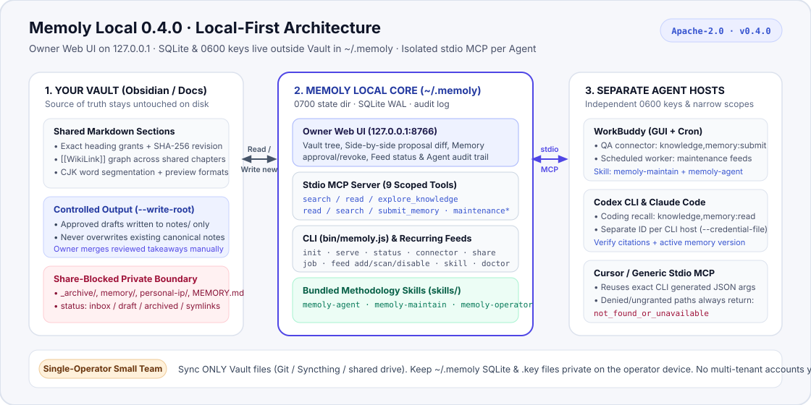
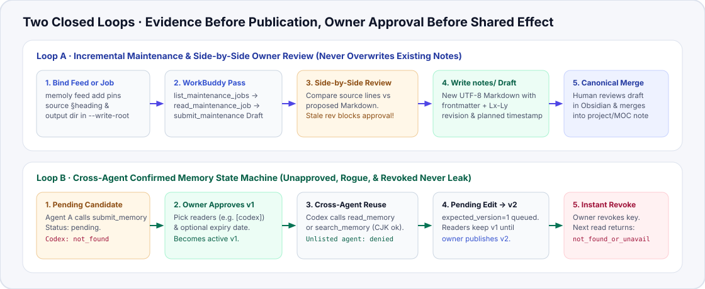

<div align="center">

# Memoly Local

**Citation-grounded Vault knowledge, owner-reviewed maintenance drafts, and confirmed cross-agent memory for local desktop Agents.**

[English](README.md) · [简体中文](README.zh-CN.md) · [Open Interactive Landing (`site/index.html`)](site/index.html) · [Releases](https://github.com/stella-dust/memoly/releases) · [Apache-2.0](LICENSE)

</div>



Memoly Local turns an Obsidian Vault or Markdown directory into a **section-scoped, revision-pinned evidence store** and a **human-approved cross-agent memory ledger**.

- **For individuals**: Connect WorkBuddy, Codex CLI, Claude Code, or Cursor to exact sections of your Vault without exposing private folders (`MEMORY.md`, `_archive/`, drafts). Let WorkBuddy run recurring maintenance and keep only owner-reviewed drafts in `notes/`.
- **For single-operator small teams**: One operator hosts Memoly locally with their team's shared Vault folder synced via Git, Syncthing, or shared drive. Vault notes sync across devices; SQLite state and `.key` credentials stay private on the operator's machine. _(Multi-user logins, SaaS hosting, and enterprise SSO are intentionally not part of Memoly Local.)_

> Tip: Download or clone the repository and open [`site/index.html`](site/index.html) in any browser to explore the interactive bilingual landing page offline.

---

## Architecture & Closed-Loop Workflows



Memoly combines **five layers** on your device:
1. **Local SQLite WAL & File Projection (`~/.memoly`)**: Enforces chapter grants `(client_id, path, heading, SHA-256 revision)` and stores memory states (`pending -> active vN -> superseded / revoked`).
2. **Stdio MCP Server (9 Tools)**: Separate connector process per Agent host, exposing only tools authorized by that host's scopes (`knowledge`, `memory:read`, `memory:submit`, `maintenance`).
3. **Loopback Owner Web UI (`127.0.0.1:8766`)**: Bearer-token gated console for inspecting files with line numbers, approving side-by-side maintenance proposals, confirming/revoking memories, and checking Agent audit trails.
4. **CLI (`memoly`)**: Manages initialization, connectors, exact chapter shares, recurring maintenance feeds (`memoly feed`), bundled skills, and diagnostics.
5. **Bundled Skills & Methodology (`skills/`, [`docs/methodology.md`](docs/methodology.md))**: Ready-to-use `memoly-agent`, `memoly-maintain`, and `memoly-operator` playbooks.

---

## Install (v0.4.0)

Requires **Node.js 22.13+** and `npm`. Download `memoly-local-0.4.0.tgz` and `memoly-local-0.4.0.tgz.sha256` from [GitHub Releases](https://github.com/stella-dust/memoly/releases) into the same folder:

```sh
MEMOLY_ARCHIVE="$PWD/memoly-local-0.4.0.tgz"
shasum -a 256 -c "${MEMOLY_ARCHIVE##*/}.sha256" &&
  npm install --global --prefix "$HOME/.local/memoly" --ignore-scripts "$MEMOLY_ARCHIVE"
export PATH="$HOME/.local/memoly/bin:$PATH"
memoly --version
```

Keep `$HOME/.local/memoly/bin` on `PATH` (or invoke `"$HOME/.local/memoly/bin/memoly"` directly).

---

## 5-Minute Quickstart (Synthetic Fixture Vault)

```sh
MEMOLY_DEMO="$(mktemp -d "${TMPDIR:-/tmp}/memoly-demo.XXXXXX")"
tar -xzf "$MEMOLY_ARCHIVE" -C "$MEMOLY_DEMO" package/examples/vault
export MEMOLY_STATE="$MEMOLY_DEMO/state"
memoly init --vault "$MEMOLY_DEMO/package/examples/vault" --write-root notes
memoly serve
```

Open the printed `http://127.0.0.1:8766/#owner=...` URL, inspect `inbox/shift-handoff.md` (`Lockout review`), and grant a connector:

```sh
memoly connector add workbuddy --scopes knowledge,memory:submit
memoly share workbuddy inbox/shift-handoff.md 'Lockout review'
memoly connector config workbuddy
```

Ask your Agent using only the Memoly connector:
> Query `MEMOLY-DEMO-314` via `search_knowledge`, then call `read_knowledge` using the returned `document_id`, `heading`, and `revision`. Return the exact serial number, file path, and line numbers.

Expected answer: `MEMOLY-DEMO-314` cited at `inbox/shift-handoff.md#Lockout review` line 7. Asking about unlisted facts returns `no_evidence`. Switching to your own Vault: run `memoly init --vault "/path/to/my-vault" --state "$HOME/.memoly/my-vault" --write-root notes`.

---

## Multi-Agent Setup Matrix

Assign **one distinct connector ID and 0600 credential per Agent host**. Full configurations and copyable prompts are in [**Multi-Agent Integration Guide (`docs/agents.md`)**](docs/agents.md) and [**WorkBuddy Recurring Guide (`docs/workbuddy.md`)**](docs/workbuddy.md).

| Agent Category | Typical Host | Recommended Scopes | Core Usage | Guide |
| --- | --- | --- | --- | --- |
| **Desktop GUI + Cron** | WorkBuddy | Q&A: `knowledge,memory:submit`<br>Worker: `maintenance` | Cited Q&A, propose preferences, weekly incremental feed triage | [`docs/workbuddy.md`](docs/workbuddy.md) |
| **Terminal Coding CLI** | Codex CLI, Claude Code | `knowledge,memory:read` | Verify architectural/doc citations and confirmed habits | [`docs/agents.md`](docs/agents.md#2-terminal-coding-agents-codex-cli--claude-code) |
| **IDE & Generic MCP** | Cursor, Windsurf, custom stdio | `knowledge,memory:read` | Scoped workspace docs + live revocation control | [`docs/agents.md`](docs/agents.md#3-ide--generic-stdio-mcp-hosts-cursor--windsurf--custom-agents) |

---

## Daily Workflows: CLI, MCP, Skills & Methodology

| Capability | Owner / Operator Action (CLI & Web UI) | Agent MCP Action |
| --- | --- | --- |
| **Cited Q&A & Graph Hops** | `memoly share <id> <path> "<Exact Heading>"` · Web UI multi-chapter grant/revoke | `search_knowledge`, `read_knowledge`, `explore_knowledge` |
| **Recurring / One-Off Maintenance** | `memoly feed add <id> <path> "<Heading>" <dir>` · `memoly job add` · Side-by-side publish to `notes/` | `list_maintenance_jobs`, `read_maintenance_job`, `submit_maintenance` |
| **Manual Canonical Merge** | Human reviews `notes/` drafts and merges into permanent project notes ([`docs/methodology.md`](docs/methodology.md)) | Agents never edit existing canonical notes directly |
| **Cross-Agent Memory** | Owner approves candidate, selects allowed `readers`, approves `v2` or revokes (`127.0.0.1:8766`) | `submit_memory` (`pending`), `read_memory`, `search_memory` (CJK supported) |
| **Bundled Skills** | `memoly skill list` · `memoly skill path` | Install `memoly-agent`, `memoly-maintain`, `memoly-operator` |

---

## Data, Security Boundaries & Troubleshooting

- **Loopback Web UI**: Listens only on `127.0.0.1` with an ephemeral per-launch owner token and strict CSP. Never share this URL.
- **State Isolation**: `~/.memoly` (`0700`) and connector `.key` files (`0600`) must live **outside** your Vault directory. Revoking an active key (`memoly connector revoke <id>`) immediately blocks future calls; excerpts already sent to cloud LLM providers remain subject to that host's retention policy.
- **Readable Formats**: UTF-8 `.md`, `.txt`, `.csv`, `.canvas`, and `.base` can be previewed; exact chapter sharing and maintenance operate exclusively on unique Markdown headings (notes marked `status: inbox/draft/archived/superseded` cannot be shared externally until promoted).
- **Diagnostics & Backups**: Run `memoly doctor` and `memoly status`. Stop scheduled tasks and `memoly serve` before copying both Vault and state directories.

---

## Development from Source

```sh
git clone https://github.com/stella-dust/memoly.git
cd memoly
npm ci --ignore-scripts
npm test
node bin/memoly.js doctor
node bin/memoly.js skill list
```

If packaging from a source checkout: `npm pack --ignore-scripts` and install cleanly with `npm install --global --prefix "$HOME/.local/memoly" --ignore-scripts ./memoly-local-0.4.0.tgz`. Please use only synthetic Markdown data in issues and pull requests.

[Contributing (`CONTRIBUTING.md`)](CONTRIBUTING.md) · [Security (`SECURITY.md`)](SECURITY.md) · [Changelog (`CHANGELOG.md`)](CHANGELOG.md) · [Apache-2.0 (`LICENSE`)](LICENSE)
