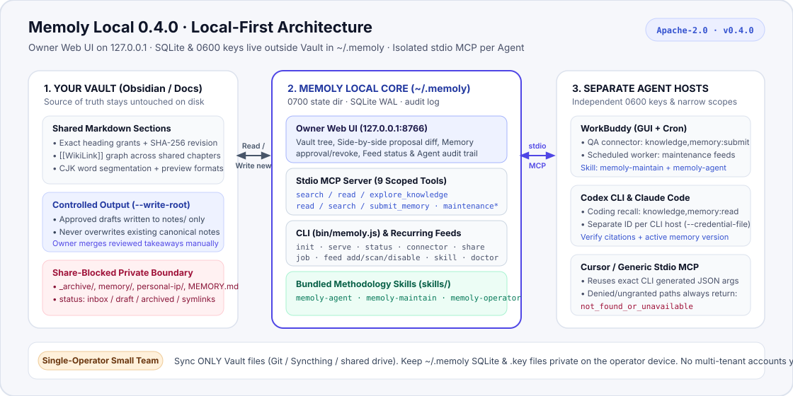
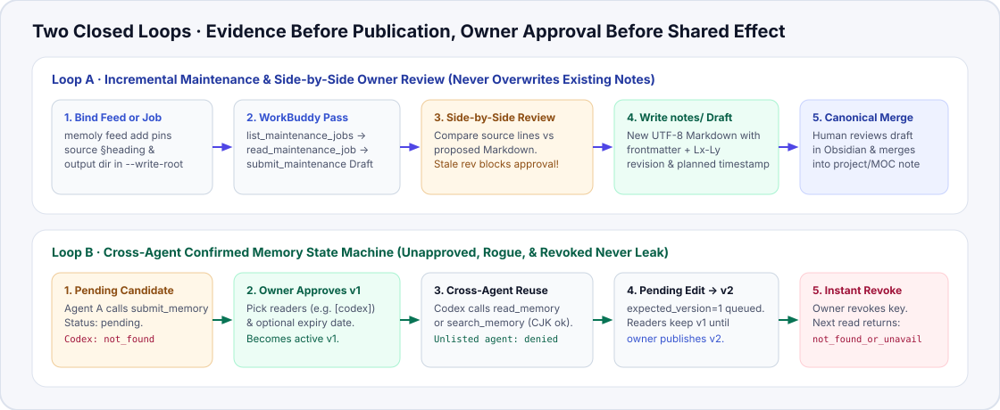

<div align="center">

# Memoly Local

**把本机 Obsidian Vault 接给常用 Agent：答案带行号出处，定时整理先审后写，确认过的记忆跨助手复用。**

[简体中文](README.zh-CN.md) · [English](README.md) · [打开交互落地页 (`site/index.html`)](site/index.html) · [下载与校验摘要](https://github.com/stella-dust/memoly/releases) · [Apache-2.0](LICENSE)

</div>



Memoly Local 把本机 Markdown 目录或 Obsidian 库变成**按章节授权、带版本哈希锁定的证据库**与**经本人批准的跨 Agent 记忆账本**：

- **面向个人**：把常用章节接给 WorkBuddy、Codex CLI、Claude Code、Cursor 等本机客户端，敏感目录（`MEMORY.md`、`_archive/`、草稿）默认屏蔽。WorkBuddy 可周期性扫描指定章节提出整理草稿，仅由本人在工作台核对原件并写入 `notes/`。
- **面向单一操作者的小团队**：由一位管理员在本机运营工作台，团队通过 Git / Syncthing / 网盘只同步 **Vault 目录**，连接器凭据（`0600`）与 SQLite 数据库留在操作者本机私有状态目录中。（多租户账号、云端 SaaS 与企业 SSO 不在本机开源版范围内。）

> 提示：克隆或解压源码后，用任意浏览器本地打开 [`site/index.html`](site/index.html) 即可离线体验中英双语交互落地页（模拟证据点选、定时维护并排审阅与跨 Agent 记忆 5 步状态机）。

---

## 核心架构与双闭环工作流



Memoly Local 在本机由五层组成：
1. **本机 SQLite WAL 与目录投影（`~/.memoly`）**：锁定 `(连接器 ID, 文件路径, 精确标题, SHA-256 版本)`，维护记忆状态机（`pending -> active vN -> superseded / revoked`）。
2. **Stdio MCP 服务端（9 个受控工具）**：按连接器身份和所授 scopes 开放最小工具集，未授权、待审与已撤回统一返回 `not_found_or_unavailable`。
3. **本机回环工作台（`127.0.0.1:8766`）**：带行号浏览器、原件与提案并排对比、记忆版本批准/撤回、增量订阅状态与审计日志。
4. **CLI 工具（`memoly`）**：负责初始化、连接器配置、章节授权、定时订阅（`memoly feed`）、内置 Skill 查询与自检。
5. **内置 Skills 与方法论（`skills/`、[`docs/methodology.md`](docs/methodology.md)）**：随包附带 `memoly-agent`、`memoly-maintain`、`memoly-operator`。

---

## 安装（v0.4.0）

需要 **Node.js 22.13+** 和 `npm`。从 [GitHub Releases](https://github.com/stella-dust/memoly/releases) 下载 `memoly-local-0.4.0.tgz` 与 `memoly-local-0.4.0.tgz.sha256` 到同一目录后执行：

```sh
MEMOLY_ARCHIVE="$PWD/memoly-local-0.4.0.tgz"
shasum -a 256 -c "${MEMOLY_ARCHIVE##*/}.sha256" &&
  npm install --global --prefix "$HOME/.local/memoly" --ignore-scripts "$MEMOLY_ARCHIVE"
export PATH="$HOME/.local/memoly/bin:$PATH"
memoly --version
```

新开终端时记得保留 `"$HOME/.local/memoly/bin"` 在 `PATH` 中，或直接使用完整路径运行。

---

## 五分钟上手（用自带合成 Vault 启动）

```sh
MEMOLY_DEMO="$(mktemp -d "${TMPDIR:-/tmp}/memoly-demo.XXXXXX")"
tar -xzf "$MEMOLY_ARCHIVE" -C "$MEMOLY_DEMO" package/examples/vault
export MEMOLY_STATE="$MEMOLY_DEMO/state"
memoly init --vault "$MEMOLY_DEMO/package/examples/vault" --write-root notes
memoly serve
```

打开终端打印的 `http://127.0.0.1:8766/#owner=...`，在「知识 Vault」检查 `inbox/shift-handoff.md` 的 `Lockout review` 行号，再给连接器授第一个章节权限：

```sh
memoly connector add workbuddy --scopes knowledge,memory:submit
memoly share workbuddy inbox/shift-handoff.md 'Lockout review'
memoly connector config workbuddy
```

在所选 Agent 新会话中验证：
> 只使用 Memoly 连接器。先用 `search_knowledge` 查询 `MEMOLY-DEMO-314`，再按返回的 `document_id`、章节与 `revision` 调用 `read_knowledge`，给出序列号、文件与精确行号。

预期准确返回 `MEMOLY-DEMO-314`（对应 `inbox/shift-handoff.md` 第 7 行）；询问无关内容时返回 `no_evidence`。接入自己的 Vault 时运行：
`memoly init --vault "/path/to/my-vault" --state "$HOME/.memoly/my-vault" --write-root notes`

---

## 面向不同类型 Agent 的接入指南

不同宿主与任务必须使用**独立的连接器身份与 `.key` 凭据**。详细命令、配置与提示词模板见 [**多 Agent 接入说明（`docs/agents.md`）**](docs/agents.md) 与 [**WorkBuddy 与定时整理手册（`docs/workbuddy.md`）**](docs/workbuddy.md)。

| Agent 类型 | 典型宿主 | 推荐 `--scopes` | 典型分工 | 详细文档 |
| --- | --- | --- | --- | --- |
| **桌面助手 + 定时调度** | WorkBuddy | 日常问答：`knowledge,memory:submit`<br>定时维护：`maintenance` | 查证问答、提出偏好候选；独立身份执行每周增量订阅整理 | [`docs/workbuddy.md`](docs/workbuddy.md) |
| **终端编程助手** | Codex CLI、Claude Code | `knowledge,memory:read` | 读取项目决策章节与本人确认的工作偏好 | [`docs/agents.md`](docs/agents.md#2-terminal-coding-agents-codex-cli--claude-code) |
| **IDE / 通用 Stdio MCP** | Cursor、Windsurf 等 | `knowledge,memory:read` | 按项目章节授读，随时可由操作者单点撤销 | [`docs/agents.md`](docs/agents.md#3-ide--generic-stdio-mcp-hosts-cursor--windsurf--custom-agents) |

---

## 知识读写、维护与方法论全貌

| 能力维度 | 所有者操作（CLI + 回环工作台） | Agent 通过 MCP 触发 |
| --- | --- | --- |
| **知识检索与图谱跳转** | `memoly share <id> <相对路径> "<精确标题>"`；工作台多章节独立启停与中文切词检索 | `search_knowledge`、`read_knowledge`、`explore_knowledge` |
| **周期增量维护** | `memoly feed add <id> <原件> "<章节>" <写回子目录>`；原件并排核对后再创建 `notes/` 草稿 | `list_maintenance_jobs`、`read_maintenance_job`、`submit_maintenance` |
| **规范归并（人工最后一步）** | 在 Obsidian 打开批准写进 `notes/` 的草稿，依个人/团队结构手动合入正式项目卡（[`docs/methodology.md`](docs/methodology.md)） | Agent 永远无权直接覆写已有正式笔记 |
| **跨 Agent 记忆** | 在「个人记忆」核对候选、指定可读 `readers`、批准 v1/v2（高亮检测过时基准）或一键撤回 | `submit_memory`（仅入待审）、`read_memory`、`search_memory`（支持中文） |
| **内置 Skills** | `memoly skill list` / `memoly skill path` 查看随包分发的规范文件 | `memoly-agent` · `memoly-maintain` · `memoly-operator` |

---

## 安全与运行边界

- Web 工作台仅监听 `127.0.0.1` 并每次启动生成一次性所有者密钥，请勿外泄终端打印的带 `#owner=...` 链接。
- 状态目录（`0700`）与 `.key` 凭据（`0600`）必须保存在 Vault 之外。撤销连接器 `memoly connector revoke <id>` 即刻阻断后续访问；已送往第三方云端模型的文本遵循宿主自身数据处理条款。
- 工作台可预览 UTF-8 `.md` / `.txt` / `.csv` / `.canvas` / `.base`；外部共享与整理只围绕**唯一 Markdown 章节标题**展开，且带有 `status: inbox / draft / archived / superseded` 的文档默认禁止外部读取。
- 备份前请先停止定时任务与 `memoly serve`，同时备份 Vault 目录与完整状态目录；日常排障运行 `memoly doctor` 与 `memoly status`。

---

## 从源码开发

```sh
git clone https://github.com/stella-dust/memoly.git
cd memoly
npm ci --ignore-scripts
npm test
node bin/memoly.js doctor
node bin/memoly.js skill list
```

贡献与安全报告请附带合成 Markdown 示例。 [贡献指南 (`CONTRIBUTING.md`)](CONTRIBUTING.md) · [安全报告 (`SECURITY.md`)](SECURITY.md) · [更新日志 (`CHANGELOG.md`)](CHANGELOG.md) · [Apache-2.0 (`LICENSE`)](LICENSE)
